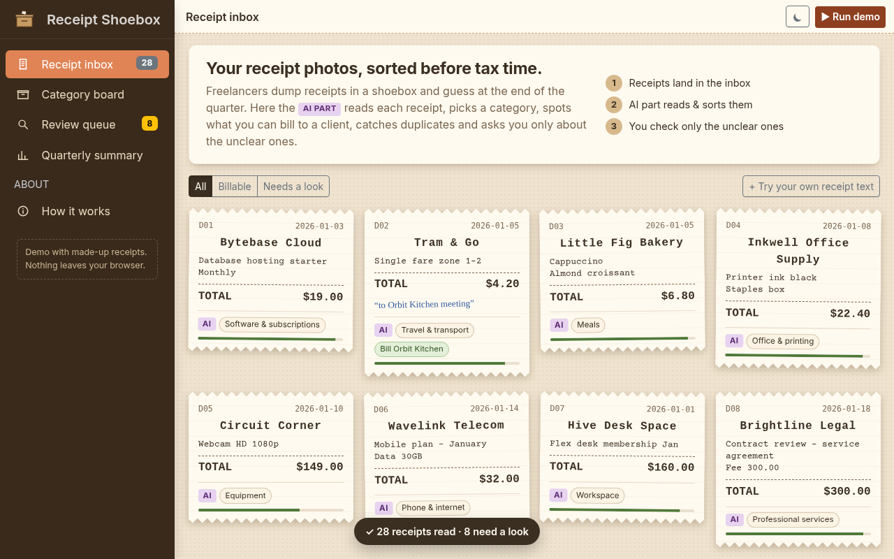

# Receipt Shoebox

Sort a quarter of freelancer receipts in one click: category, billable-to-client, duplicates, and a short Review queue for the unclear ones.



## The problem
Freelancers often keep receipt photos in one pile (a "shoebox", a camera roll, an email folder). At the end of each quarter they have to guess:
- which category each receipt belongs to,
- which ones they can re-bill to a client,
- whether the same receipt was saved twice.

People describe this pain in public forums such as Reddit's r/Entrepreneurs. This project is my take on it. All data here is synthetic.

## The solution (one click)
Open `web/index.html` (or run `npm run serve` and go to http://localhost:8851), then press **Run demo**. 28 made-up Q1 2026 receipts are read one by one, and you get:

| Screen | What it does |
|---|---|
| **Receipt inbox** | Receipts drawn as paper slips. Each one shows the AI part's category, a confidence bar, a "Bill <client>" chip and a "Duplicate?" chip. A small cat doodle sits beside the unclear ones. You can also paste your own receipt text. |
| **Category board** | Shoebox-style boxes, one per category. Drag a receipt into another box to re-file it (mouse and touch). The box bumps and a "filed!" toast appears. |
| **Review queue** | Only the unclear receipts, each with the reason and one question ("What was this for?"). You pick the category and client, then file it or remove a duplicate. |
| **Quarterly summary** | Totals, spend by category (Chart.js), billable vs own costs by month, the amount to re-bill per client, and CSV export (all receipts or billable only). |

Dark mode is the button in the top bar.

## What is "AI" and what is rules
Being honest about this matters:

- **The "AI part" in this demo is a rule and keyword engine** (`web/engine.js`, about 150 lines of plain JS). It is not a trained model and does no real OCR. Receipts come in as OCR-like text.
  - **Category:** keyword scoring per category, with a confidence based on the margin between the top two categories. Common OCR digit swaps (0→o, 4→a…) are normalised first.
  - **Billable:** yes when the note names a known client. A duplicate inherits billable status from the original.
  - **Duplicates:** same shop, same total, same text, within 2 days.
  - **Review routing:** unreadable text, mixed items, items that look personal, refunds, likely duplicates, big travel/meals/other spend with no note, or a no-note receipt from a shop that was billed to a client before.
- **Optional LLM hook:** `analyse(receipt, { llmHook })` lets a language model refine the result, with a fallback to the rules if it throws. **It is untested.** No API key is used and the demo never calls it.
- **Rules only, no AI at all:** the drag-and-drop, the Review queue actions, the charts and the CSV export.

## Results (measured, self-written test set)
I wrote a **held-out set of 40 receipts before writing any rules** (`data/heldout.json`, the first commit in this repo). I tuned the rules only on the 28 demo receipts. Run `npm run eval` to reproduce.

| Held-out set (40 receipts) | Result |
|---|---|
| Category correct | **39 / 40** |
| Billable flag correct | **40 / 40** |
| Review routing correct (sent to review or not) | **37 / 40** |
| Category, billable, review and duplicate all correct | **36 / 40** |
| Duplicates | **2 / 2 caught, 0 false flags** |
| Review queue | 9 of 11 that needed review were caught, 2 missed, 1 sent unnecessarily |

On the dev/demo set the rules were tuned on (28 receipts), the score is 27/28 category and 28/28 for the rest. That number is inflated because of the tuning, so don't quote it.

**Misses on the held-out set:**
- A mixed supermarket receipt (cable, paper, soap, snacks) got the wrong category, but it was still sent to review.
- A receipt from a café that a client had been billed for before, with no note, went to review when I had marked it as fine. That's a judgement call.
- An online course went to the wrong place: the engine has no rule for "is training a business expense?".
- A refund went to the wrong place: the receipt text says −329 but the structured total field was positive. The engine trusts the field and never cross-checks the printed total.

## Limits
- **I wrote the test receipts myself, after designing the categories.** Real receipt photos will be messier and scores will be lower.
- There is no real OCR. A production version would need an OCR step, and OCR errors would add up.
- Billable detection only works when the user writes a note naming the client. Without a note, the best it can do is ask.
- Duplicate detection needs identical text. Two different photos of the same receipt with different OCR output would be missed.
- The LLM hook is untested. Nothing in the results above uses an LLM.
- Data lives in the browser only. There is no storage, accounts or sync.

## Run the tests
```bash
npm test             # node --test: engine, CSV, duplicate, licence and privacy checks
npm run eval         # held-out evaluation
python3 scripts/shots.py /tmp/shots   # headless Playwright: 1280 px and 390 px, light and dark, real drag-and-drop + toast
python3 scripts/touch_check.py        # touch drag on a phone viewport
```
(The Playwright scripts expect `npm run serve` running.)

## Built with
[AdminLTE 4](https://adminlte.io) (Bootstrap 5.3) and [Chart.js 4](https://www.chartjs.org), vendored in `web/vendor/` with their MIT licences. There is no build step.

## Licence
MIT. All receipts, shops and clients are invented.
